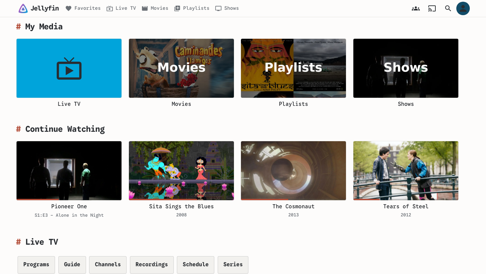
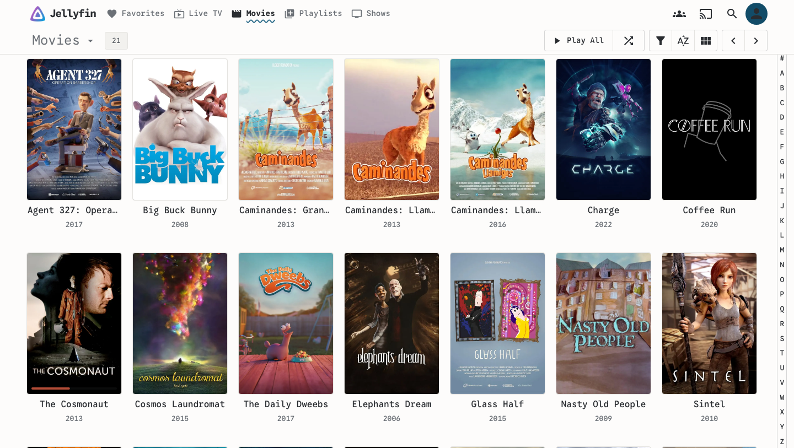
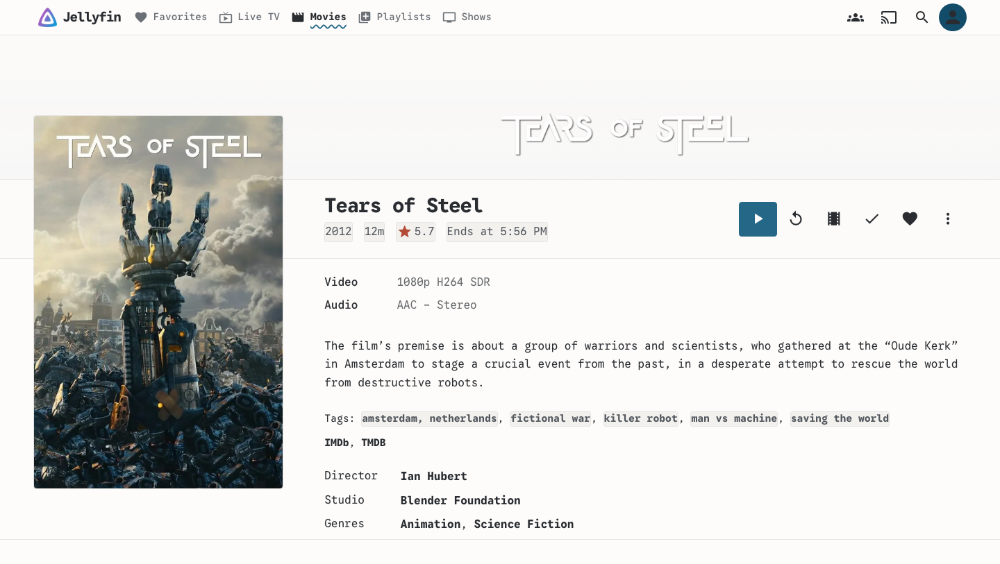
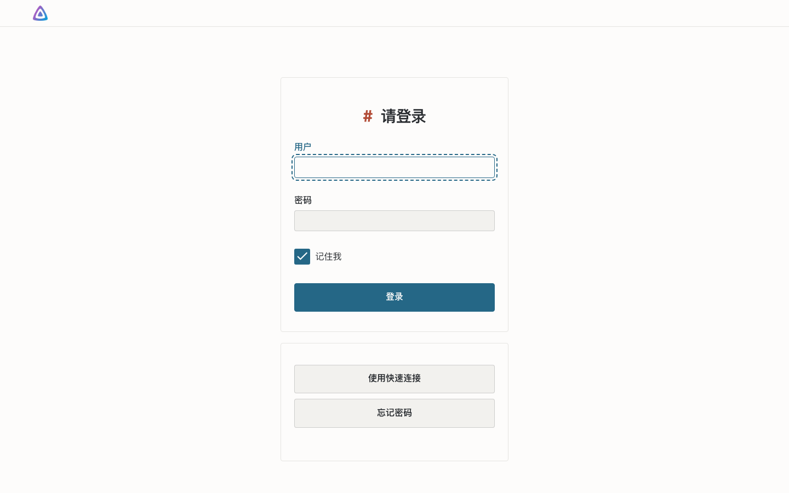

# Swiss Paper for Jellyfin

A minimalist **warm-paper light monospace theme** for Jellyfin (`10.10`, `10.11`, and `12+`), inspired by Swiss International Typographic Style.

> Built for readers and media collectors who want calm, daylight-first typography, `1px` hairline structure, and zero visual clutter.

## Preview

| Home | Library | Item Detail | Sign In |
| :---: | :---: | :---: | :---: |
|  |  |  |  |

## Installation

### Single-URL CSS Import (Recommended)

Paste the line below into **Dashboard → General → Branding → Custom CSS** (for all users) or **Settings → Display → Custom CSS** (for your account only), then click **Save**:

```css
@import url("https://cdn.jsdelivr.net/gh/chius-n/jellyfin-theme-swiss@main/swiss-paper.css");
```

You do **not** need to switch your client theme to Light manually — Swiss Paper overrides both `html[data-theme="dark"]` and `html[data-theme="light"]` tokens so every client renders in warm-paper light mode out of the box.

> **Admin Dashboard Note:** By design, Jellyfin does not inject Custom CSS into `/dashboard` admin pages. Set **Settings → Display → Dashboard Theme** to **Light** (or use a JavaScript injector plugin if you want Custom CSS on admin pages too).

## Design Highlights

- **Warm Paper Palette**: `#fdfcfb` warm paper canvas, `#292c30` primary ink (`13.69:1` AAA contrast), `#256786` slate-blue primary actions, and `#b24c37` brick-red `#` markers, unplayed badges, and resume bars.
- **Monospace Mixed-Script Typography**: `Google Sans Code` + `Sarasa Mono SC` / `PingFang SC` with `tabular-nums` alignment for durations, episode counts, and timestamps, while preserving Material Icons & MUI SVG ligatures.
- **Jellyfin 12 Modern + Legacy Support**: Bridges all `--jf-palette-*` and `*Channel` variables, styles `.MuiAppBar-root` with wavy active underlines, turns filter/sort `MuiButtonGroup` controls into `1px` hairline segmented bars, and hides the AppBar cleanly during fullscreen playback.
- **Zero-Displacement Interactions**: No card zoom, tilt, or shadow bloat on hover; instant `2px dashed` keyboard focus rings (`:focus-visible`) and full `prefers-reduced-motion` support.
- **Scoped Cinema-Dark Player OSD**: Keeps fullscreen video playback controls dark (`rgb(26 30 38 / 0.90)`) to avoid bright glare during movies.

## Customization

Override any `:root` CSS variables after the `@import` line:

```css
@import url("https://cdn.jsdelivr.net/gh/chius-n/jellyfin-theme-swiss@main/swiss-paper.css");

:root,
html[data-theme="dark"],
html[data-theme="light"] {
    --accent: #256786;
    --accent-hover: #124c68;
    --mark: #b24c37;
}
```

## Credits

Interaction patterns and Jellyfin 12 layout fixes draw inspiration from community themes in [awesome-jellyfin](https://github.com/awesome-jellyfin/awesome-jellyfin), including [ElegantFin](https://github.com/lscambo13/ElegantFin), [elegantfin-jf12](https://github.com/mihaif7/elegantfin-jf12), [Netflin](https://github.com/ahza-code/Netflin), [Jellyfish](https://github.com/n00bcodr/Jellyfish), [NeutralFin](https://github.com/KartoffelChipss/NeutralFin), and [Catppuccin](https://github.com/catppuccin/jellyfin).

## License

[MIT](LICENSE)
